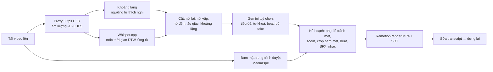

# Auto Video Studio

Tải video thô lên, nhận về video đã dựng xong: cắt khoảng lặng, bỏ đoạn nói lại, phụ đề từng từ chuẩn tiếng Việt, tự động chỉnh màu & chỉnh màu tay kiểu CapCut, timeline kéo thả, zoom theo nhịp, thẻ số, emoji, âm thanh hiệu ứng, nhạc nền.

👉 **Dùng online (GitHub Pages):** https://bastrxxx.github.io/auto-video-studio/
- **Tài khoản đăng nhập:** `sts` / **Mật khẩu:** `1111`

Dự án kết hợp 2 repo:

| Lấy từ | Phần dùng |
|---|---|
| [remotion-dev/remotion](https://github.com/remotion-dev/remotion) | Engine render (React → MP4), `@remotion/install-whisper-cpp` nhận dạng giọng nói từng từ, ffmpeg đi kèm, Google Fonts có tiếng Việt |
| [kurbaitaev/ghost-editor](https://github.com/kurbaitaev/ghost-editor) | Cách biên tập: chọn take (take sau thắng, bỏ câu bắt đầu hỏng và câu “làm lại”), autocut (khoảng lặng lấy từ âm thanh, chừa lại hơi thở), phụ đề không che mặt trong vùng an toàn của nền tảng, zoom snap/push, các kiểu beat (thẻ số, emoji…), mức âm thanh hiệu ứng theo vai trò, các style preset, model bám mặt MediaPipe, âm thanh CC0 |

ghost-editor vốn là một *skill* cho Claude Code: con người hoặc agent phải tự viết `reel.json`. Ở đây toàn bộ bước đó **chạy tự động**: luật heuristic + AI (Gemini, tuỳ chọn) tạo ra kế hoạch dựng, rồi Remotion render.

## Chạy

**macOS:** nhấp đúp `Chạy Auto Video.command`. Lần đầu nó tự cài Node (bản di động), các gói npm, whisper.cpp + model, thư viện âm thanh/nhạc, rồi mở http://localhost:8790.

Thủ công:
```bash
npm install
npm run setup:whisper          # build whisper.cpp + model "small" (tiếng Việt chuẩn hơn: npm run setup:whisper -- medium)
npm run setup:library          # (tuỳ chọn) âm thanh + nhạc nền Mixkit, tải về máy bạn
npm start                      # http://localhost:8790
```
Cần: macOS/Linux có `git`, `make`, trình biên dịch C (Xcode Command Line Tools), và mạng internet ở lần chạy đầu (Chrome Headless, font, model).

## Quy trình



## Tính năng
- **Nhiều video trong 1 dự án**: kéo thả nhiều clip cùng lúc (hoặc bấm “+ Thêm video”), chương trình ghép thành 1 video. Có 4 cách sắp thứ tự:
  - ✨ **Tự động**: theo giờ quay, rồi xét nội dung. Clip mở đầu bằng câu chào (“xin chào”, “hôm nay”, “hello”…) được đưa lên đầu, clip kết bằng lời kêu gọi (“follow”, “cảm ơn”, “đăng ký”…) xuống cuối. Nếu có Gemini key, AI đọc lời thoại của từng clip và sắp theo mạch câu chuyện.
  - 🕒 **Giờ quay**: lấy từ metadata của file (`com.apple.quicktime.creationdate` / `creation_time`). File không có metadata thì dùng thời gian sửa file, sau cùng là tên file.
  - 🔤 **Tên file**: sắp tự nhiên, IMG_2 đứng trước IMG_10.
  - ✋ **Thủ công**: kéo thả thẻ clip.
  - Thêm: chuyển cảnh giữa các clip (loé sáng / mờ qua đen / âm thanh vút / cắt thẳng). Clip dọc và clip ngang dùng chung được trong một video. Câu nói lại ở clip trước bị bỏ, giữ bản ở clip sau. Clip không có lời (B-roll) được giữ nguyên.
- **Tự cắt**: khoảng lặng (3 nhịp), câu nói lại / bắt đầu hỏng (so khớp mờ, take sau thắng), câu “làm lại / okay again” cùng take bị bỏ dở trước nó, nói vấp (“tôi nghĩ tôi nghĩ”), từ đệm (ờ, ừm, uh), chữ Whisper bịa ra trên đoạn im lặng, giới hạn thời lượng (giữ câu mở đầu, câu kết và các câu hay nhất).
- **Phụ đề** từng từ, 8 phong cách (Clean, Hormozi, Meme, Editorial, Cinematic, Caption News, Pop, Minimal). Phụ đề được đặt dưới cằm, nếu không đủ chỗ thì lên trên đầu, nếu vẫn không được thì đặt trên nền tối. Luôn nằm trong vùng an toàn của TikTok/Reels/Shorts. Có thêm tự sửa chính tả và xuất `.srt`.
- **Máy quay**: zoom snap ở mỗi vết cắt và đầu câu, push chậm ở các take dài. Đổi khung 16:9 → 9:16 bằng cách crop bám theo mặt, giữ khung cố định trong mỗi take. Có chế độ nền mờ.
- **Beat**: thẻ số lớn có đếm số (50%, \$3,000, 10 triệu…), emoji bật lên cạnh đầu, tiêu đề hook, thẻ chủ đề, end card CTA trên khung hình đóng băng, thanh tiến trình.
- **Âm thanh**: whoosh/impact/pop/riser/ding đặt mức theo vai trò so với giọng nói. Nhạc nền chọn theo mood của phong cách, thấp hơn giọng khoảng 20 dB và tự hạ âm lượng khi có người nói. Hai frame fade ở mỗi vết cắt để không bị tiếng “tách”.
- **Nhận dạng tiếng Việt chuẩn xác hơn**:
  - Mặc định dùng model **`large-v3`** (đã cài sẵn, tăng tốc Metal GPU) cùng ngôn ngữ mặc định **`vi`**, giải mã **beam search (`-bs 5`)**, tách từ chuẩn (`--split-on-word`), và cắt bỏ khoảng lặng đầu/cuối trước khi chạy Whisper để tránh ảo giác.
  - Tự động nạp **prompt tiếng Việt có dấu + từ vựng từ ô Ý tưởng video & từ điển sửa từ** vào `--prompt` của Whisper để nhận đúng tên riêng, thuật ngữ, dấu thanh.
  - Nếu bật Gemini (`aiFixCaptions`), AI sẽ đọc lại toàn bộ phụ đề theo ngữ cảnh ý tưởng video để sửa dấu tiếng Việt, từ đồng âm, chữ bị tách/ghép âm tiết rồi căn lại vào mốc thời gian gốc của từng từ.
- **Ô “💡 Ý tưởng & mong muốn cho video” (`brief`)**: mô tả chủ đề, đối tượng người xem, tông giọng, thông điệp chính, tên thương hiệu/sản phẩm hoặc bố cục mong muốn. Nội dung này được truyền xuyên suốt cho:
  1. **Whisper** (gợi ý ngữ cảnh & từ vựng chuyên ngành khi nhận dạng giọng nói),
  2. **AI sửa chính tả phụ đề** (hiểu ngữ cảnh để sửa từ nghe nhầm),
  3. **Sắp xếp thứ tự nhiều clip** (chọn mạch câu chuyện đúng ý đồ),
  4. **AI biên tập (Gemini)** (chọn câu giữ/bỏ, đặt tiêu đề mở đầu, chọn từ khoá nhấn mạnh và điểm chèn hiệu ứng).
- **Chỉnh sửa từng câu phụ đề theo timing + Timeline kéo thả kiểu CapCut**:
  - **Xem trước trực tiếp (`@remotion/player`)**: mọi thao tác sửa chữ, kéo thả đoạn cắt, đổi hiệu ứng hay đổi phong cách đều cập nhật ngay trên màn hình xem trước mà không cần chờ render lại MP4.
  - **Timeline đa lớp (`🎬 Video`, `💬 Phụ đề`, `✨ Hiệu ứng`)**: kéo thân khối để di chuyển/đổi chỗ đoạn video, kéo 2 cạnh trái/phải để cắt ngắn/kéo dài (trim), đặt kim thời gian rồi bấm **`✂ Tách` (`S`)** để cắt đôi đoạn tại vị trí kim, **`🗑 Xoá` (`Delete`/`Backspace`)**, **`↶ Hoàn tác` (`⌘/Ctrl+Z`)** / **`↷ Làm lại` (`⇧⌘Z` / `Ctrl+Y`)** (lịch sử 80 bước), phóng to/thu nhỏ timeline, thêm phụ đề hoặc hiệu ứng mới tại vị trí kim.
  - **Sửa từng câu theo timing**: danh sách từng câu phụ đề có nút `▶` nghe thử đúng câu đó, ô sửa mốc bắt đầu – kết thúc (`giây` đến `0.01s`), ô sửa nội dung câu (tự động chia lại mốc thời gian từng từ theo độ dài chữ), bật/tắt từ khoá tô màu ngay trong Inspector, hoặc xoá câu.
  - **Xuất video từ timeline (`⬇ Xuất video`)**: biên dịch thẳng từ `timeline.json` sang Remotion để xuất MP4 + `.srt` mà không chạy lại bước phân tích.
- **Chỉnh màu kiểu CapCut** (tab `🎨 Chỉnh màu` trong trình chỉnh sửa):
  - **✨ Tự động chỉnh màu**: đo màu từng clip (lấy mẫu vài khung hình), tự cân bằng điểm đen/trắng, phơi sáng, cân bằng trắng (dựa trên vùng màu trung tính, không bị cỏ/trời làm lệch), độ bão hoà để các cảnh đồng đều. Có thanh `Mức độ` 0–100%.
  - **Bộ lọc**: Tự nhiên, Rực rỡ, Nắng ấm, Lạnh, Teal & Orange, Điện ảnh, Film cũ, Trầm, Trong trẻo, Đồ ăn, Cỏ xanh, Đen trắng, có thanh `Cường độ`.
  - **Điều chỉnh tay**: Phơi sáng, Độ sáng, Tương phản, Vùng sáng, Vùng tối, Làm mờ, Bão hoà, Nhiệt độ, Sắc thái, Tông màu, Viền tối, Hạt phim. Áp cho **toàn bộ video** hoặc **riêng đoạn đang chọn** trên timeline (có hoàn tác). Bấm đúp thanh trượt để về 0, giữ nút `👁` để so sánh với bản gốc.
  - Màu được dịch thành bộ lọc SVG (đường cong tông màu từng kênh → bão hoà → xoay màu), nên bản xem trước và file MP4 xuất ra giống hệt nhau.
- **Chỉnh trên lời thoại gốc**: bấm vào từng từ để giữ/cắt (`Shift` để chọn cả đoạn), rồi bấm **Dựng lại tự động** nếu muốn chạy lại bộ cắt tự động.

## Cấu trúc
```
server/            Node API + pipeline (prep, transcribe, edit, llm, plan, render)
shared/            Kiểu dữ liệu EditPlan, preset phong cách, toán camera (dùng chung server + Remotion)
remotion/          Composition AutoEdit: VideoTrack, Captions, Beats, Look, Sound
web/               Giao diện (HTML/JS thuần) + bám mặt MediaPipe
public/            sfx CC0, model mặt, manifest nhạc
```
`npm run studio` mở Remotion Studio với kế hoạch mẫu. `npm test -- video.mp4 --render` chạy cả pipeline không cần giao diện.

## Giấy phép
- Remotion: miễn phí cho cá nhân và công ty ≤ 3 người. Công ty lớn hơn cần [license](https://remotion.pro).
- Logic chuyển thể từ ghost-editor (MIT). Âm thanh `cc0-*` là CC0. Model MediaPipe Face Landmarker là Apache-2.0.
- Âm thanh/nhạc Mixkit (từ `setup:library`): dùng thương mại được, không cần ghi nguồn, nhưng không được phân phối lại nguyên file.
